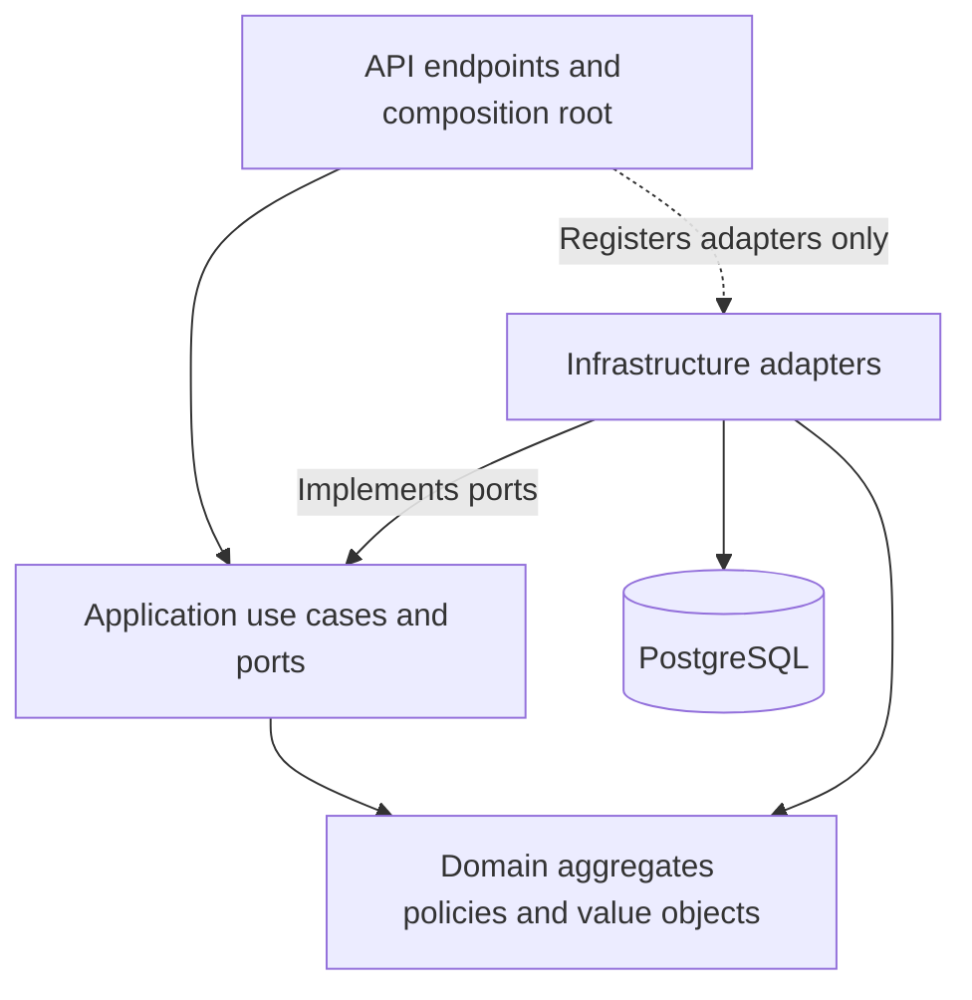

# Clean Architecture and domain-driven design

The scheduling bounded context is implemented as one deployable application with four production projects. Layer boundaries are enforced by project references and tests, while the appointment aggregate owns lifecycle behavior. This is not event sourcing: domain events are durable notifications of committed state changes, and PostgreSQL tables remain the current source of truth.

## Dependency rules

- **Domain** uses only .NET base libraries. It has no project/package/framework references and no HTTP, SQL, configuration, or logging dependencies. Time and resource-state decisions are explicit method inputs; the aggregate does not read the system clock or query a database.
- **Application** references Domain. It coordinates ownership/staff authorization, resource selection, transaction lifetime, bounded retries, and event recipient selection through `ISchedulingStore`, `ISchedulingSession`, `INotificationStore`, `IDeliveryProvider`, `IStaffDirectory`, and `IReferenceDataReader`. It never accepts SQL strings or calls a driver. Logging abstractions are its only external package dependency.
- **Infrastructure** implements those ports using Npgsql/Dapper, PostgreSQL transactions/constraints, embedded migrations, mock provider delivery, and a hosted worker. Driver failures are translated into application-owned persistence/contention exceptions, so use cases do not inspect PostgreSQL exception types or SQL-state codes.
- **API** binds HTTP requests, identifies demo actors, maps domain/application failures to Problem Details, and calls use cases. It references Infrastructure to compose dependencies and run the migration command. Business endpoints use application services/ports rather than concrete persistence types. HTTP status codes are mapped here, not carried by the domain.

`ArchitectureScenarios` checks both declared project references and compiled assembly dependencies. Adding an unused outward project reference still fails the project-reference assertions. It also verifies that aggregate/entity properties cannot be set publicly. The API's compiled references must not include Dapper or Npgsql.

## Aggregate boundary and ubiquitous language

| Concept | Responsibility |
| --- | --- |
| `ServiceAppointment` | Aggregate root for an accepted booking commitment, lifecycle revision, cancellation record, and owned execution. Exposes `Confirm`, `Cancel`, `Start`, `ReportProgress`, and `Complete`. |
| `WorkExecution` | Owned entity for actual start/completion, latest expected completion, and an independent execution revision. Mutation is internal to Domain and invoked by the aggregate. |
| `BookingOffer` | Immutable quoted terms, validity period, duration/price snapshots, and supported payment validation. No capacity is held by an offer. |
| `ServiceInterval` | Positive UTC interval with half-open overlap and full-work-fit semantics. |
| `Money` | Nonnegative amount, currency, currency rounding, and configured multiplier application. |
| `ServiceEstimate` | Positive work minutes, nonnegative buffer, and policy version. |
| `OverrunPolicy` | Determines whether a following appointment still needs recovery after resources are released. |
| `AppointmentEvent` variants | Confirmation, cancellation, progress, completion, and operational impact facts carrying immutable state at the time of the event. |

The aggregate's public state is read-only. `AppointmentSnapshot`, `ExecutionSnapshot`, and `QuoteSnapshot` are immutable records for rehydration and persistence; `Restore` entry points are for trusted persisted state, not HTTP request binding. HTTP contracts are separate Application DTOs, mapped through `Projection`, preserving the existing JSON shape. This keeps serialization/mapping concerns out of the behavior-owning entity.

Resource availability is a cross-appointment invariant. It cannot be made safe by an in-memory aggregate alone. The application locks candidate resources through the transaction port and rechecks authoritative capacity, qualifications, windows, and forecasts. Infrastructure implements these operations using globally ordered resource locks plus PostgreSQL exclusion/unique constraints. Read-only resource/qualification configuration remains outside the administration scope. General support allocation/reassignment would require extending this consistency protocol.

## Example: record an overrun

1. API binds a progress command and passes the staff actor to `OperationsService`.
2. Application verifies staff permissions, opens a unit of work, locks resources in the shared order, and loads the aggregate with its owned execution.
3. `ServiceAppointment.ReportProgress` validates lifecycle/revision/reason, updates the execution forecast, and raises `ProgressReported`. The accepted reservation and price are unchanged.
4. Application obtains affected reservations through the repository, applies `OverrunPolicy`, and records impact decisions. The aggregate raises `OperationalImpact` when needed.
5. Infrastructure persists the aggregate/execution, audit record, incidents, and routed domain events using the same database transaction. Only after commit does the API return success.
6. Notification use cases materialize and claim durable delivery work. The provider call happens after the claim transaction commits. A claim token guards acknowledgement, and abandoned leases remain recoverable.

One aggregate instance belongs to one command/unit of work. Restoring persisted state creates no new events. Idempotent cancellation/start/completion returns without raising a second transition event. Database outbox uniqueness also protects the logical event identity. Events carry snapshots, so later aggregate transitions cannot rewrite earlier event contents.

## Tests and compatibility

The 51 pre-refactor scenarios still pass through the HTTP API. New tests exercise domain behavior without ASP.NET or PostgreSQL, check dependency direction, and verify existing migration identities/data survive the project move. The full suite has 74 examples: 24 domain/rule tests, four architecture tests, and 46 integration tests. See [testing conventions](testing.md) and [recorded validation](validation.md).

Migrations moved from API to Infrastructure but keep logical names `Scheduler.Api.Database.001_initial.sql` and `Scheduler.Api.Database.002_demo_seed.sql`. Renaming those identifiers would cause an existing database to replay its initial schema; the migration compatibility test prevents that regression. No data migration or schema reset is required for this refactor. The Docker build copies all four project files before restoring dependencies.

Domain-driven design does not require a generic repository for every table, a mediator library, a message broker, separate microservices, or a runtime AI agent. The interfaces here describe the scheduling and delivery operations actually needed, including their atomicity boundaries. Full recovery workflows, external providers, production identity, and production HA remain documented extensions rather than placeholder implementations.
