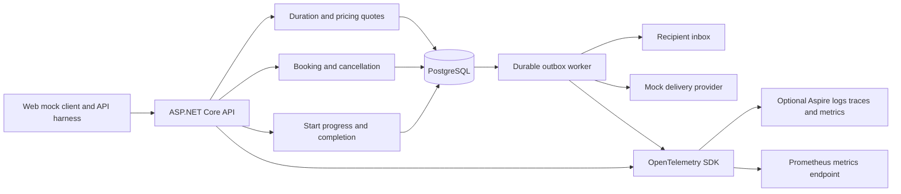
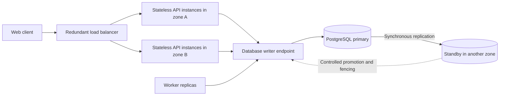

# System design and implementation boundaries

This document describes the delivered backend and the production/recovery extensions. The assessment requires Scenario A's service booking, full-duration qualified technician/bay allocation, persistence, one fully implemented layer, design/observability documentation, tests, and an AI collaboration account. The applicant added variable durations, overruns, notifications, cancellation, pricing, web-only scope, check-in payment, and the numerical service targets below. Those additions are not attributed to the PDF.

## Components and data flow

One ASP.NET Core host composes four projects: Domain, Application, Infrastructure, and API. Booking, operations, and notification use cases live in Application; lifecycle behavior and policies live in Domain; PostgreSQL and delivery adapters live in Infrastructure. This keeps a five-day assessment understandable and lets a database transaction encompass each business change and its event. Worker delivery is outside business transactions. The same application can run on multiple instances without process-local booking locks; durable delivery claims coordinate the workers. See [architecture boundaries and aggregate details](architecture.md).

ASP.NET Core and .NET 10 match the applicant's strongest stack. PostgreSQL provides transactions, range exclusion constraints, row locks, and a shared authoritative reservation ledger. Npgsql/Dapper expose explicit parameterized SQL exclusively in Infrastructure. This replaces the earlier EF Core draft proposal: less ORM machinery, but SQL/schema mapping maintenance is explicit. Embedded numbered migrations are applied atomically under an advisory lock and recorded in `schema_migration`; their original resource identities survive the project split. Production uses a separate migration job and role. OpenAPI and the executable PowerShell demo provide the mocked client. Tests exercise pure domain behavior independently and the real database through two API hosts.

1. The client requests a quote for an owned vehicle, dealership, service, and offset-qualified start.
2. The quote snapshots the configured estimate/buffer and time-band price in the dealership's zone. The quote lasts ten minutes and holds no resources.
3. Confirmation selects qualified, fully available resources and locks them in global ID order. It then locks/rechecks the quote, current reservations, and active execution forecasts.
4. Appointment, two reservations, accepted price/payment terms, and confirmation outbox event commit together. Only then does the API confirm.
5. The worker materializes recipient deliveries, claims one with a lease, commits the claim, calls the mock provider, and conditionally records the outcome using the claim token.

## Data and correctness

Reference data: Customer, Vehicle, Dealership/time zone, ServiceType, DurationRule, PricePolicy/PriceBand, Resource, Qualification, and dated Availability. Bay/technician specialization is represented by `Resource.kind`; one shared identity allows the same exclusion mechanism to cover both. Reference administration is outside the current API.

Business data: AppointmentQuote, Appointment, ResourceReservation, JobExecution, ResourceUsage, DisruptionIncident, ExecutionReport, OutboxMessage, and NotificationDelivery. `ServiceAppointment` is the domain aggregate root for the accepted commitment and its `WorkExecution`. `BookingOffer` issues and validates quotes; `ServiceInterval`, `Money`, and `ServiceEstimate` are immutable value objects. `OverrunPolicy` decides whether the following appointment has enough remaining time. Domain methods produce typed events that Application routes to recipients and Infrastructure persists in the outbox. Foreign keys connect the customer/vehicle/service/dealership and each allocated resource. All inputs are SQL parameters. Quotes and appointments persist price/duration versions. Cancelled reservations remain in history with `is_active=false`.

The shared reservation exclusion constraint rejects overlaps on `(resource_id, tstzrange(starts_at, ends_at, '[)'))` for active rows. Adjacent reservations are allowed. A partial unique index prevents two unreleased actual usages of one resource. A unique appointment quote ID makes same-quote replay safe. Reference qualifications, working-window containment, ownership, and forecast checks remain application rules enforced within the locking protocol.

Booking, cancellation, start, progress, and completion lock all relevant Resource rows in database UUID order, then the appointment/execution or quote. Candidate reads are advisory; allocation rechecks after acquiring locks. Booking uses at most three attempts with new transactions. Row lock waits are capped at 500 ms and SQL statements at five seconds. In-process locks are not relied on for correctness. The current fixed resource assignments simplify locking; a future reassignment command must recheck resource identities and preserve this order.

An unfinished job keeps its actual resources occupied until recorded completion. A stale forecast is treated as unknown, excluding those resources from new booking. Recording an overrun can overlap planned reservations and therefore must not try to extend the constrained reservation row. Instead it saves the forecast, audits the reason, identifies impacts under shared resource locks, and notifies staff. Start checks actual occupancy and unresolved incidents. Completion records the real end and reevaluates impacts; B remains affected if its full work estimate cannot fit its remaining reservation.

Cancellation and start serialize on the same resources/appointment, so only one incompatible transition wins. Cancellation releases only its own planned capacity and does not release A's actual occupancy. Price is not automatically increased for overruns or additional staffing. Payment at check-in is an arrangement, not a payment receipt.

## Notifications and recovery extensions

Delivered notification events cover confirmation, cancellation, operational progress/impact, and completion. Inbox ownership, read status, staff delivery inspection, and failed retry are implemented. Failures use bounded exponential backoff with jitter; after five failed provider attempts they become visible failures. Claim leases recover abandoned work. Logical deliveries are deduplicated by event/recipient, but an external provider could receive a duplicate after acknowledgement loss. A future adapter needs stable provider idempotency keys where supported. Provider acceptance is distinct from actual delivery, reading, and customer agreement. Cancellation can suppress an unsent confirmation; a send already in flight cannot be recalled.

The initial recovery implementation deliberately stops at truthful forecasts, incidents, capacity protection, and staff notification. The following reviewed design remains an extension:

- Staff request supporting resources and supply their judgment, reason, interval, and revised forecast. The app validates stored qualifications and capacity; it does not evaluate productivity.
- Prefer support for A, then another resource pair preserving B's time, before proposing a different time to B.
- A proposal stores the exact interval, appointment revision, expiry, and customer decision. Decline, silence, and expiry preserve B's commitment. Acceptance does not hold capacity.
- Applying an accepted proposal rechecks qualifications, full duration, working windows, downstream bookings, active occupancy, price policy, and revisions atomically. A changed interval requires fresh customer acceptance. Dealer-caused delays preserve the accepted price.
- Add reminders, actual provider adapters, general rescheduling, and production authentication alongside their workflow tests. These are not exposed as placeholder success endpoints.

## Capacity and availability

Confirmed target: 1,000 read API requests/s plus 17 distinct booking commits/s concurrently. Quote creation and notification processing add database load. Proposed confirmation thresholds: p95 <=2s and p99 <=3s, measured at the client from final booking submission through the committed response. Notifications are asynchronous. Measure errors, attempted throughput, unique commits, and all-attempt latency with successful latency; fast conflicts do not establish capacity.

The included runner uses two real processes, an isolated database, explicit arrival schedules, bounded generator concurrency, dropped-iteration reporting, and persisted-overlap validation. It drops arrivals delayed more than 100 ms rather than producing catch-up bursts. The initial workload has twenty qualified resource pairs, two customers, two duration profiles, and future dated capacity. It is a declared synthetic workload, not a production traffic model. The planned sustained exercise is five minutes warm-up plus 30 minutes measurement. Results and limitations are in `validation.md`.

This production topology is **not deployed**. The >=99.9% monthly uptime target allows 43 minutes 12 seconds downtime in a 30-day month. Independent synthetic booking journeys and production request telemetry must measure it; short tests cannot. Provision redundant load balancing, spare application capacity across zones, readiness/draining, coordinated compatible migrations, monitored database failover with fencing, backups, and restore exercises. Synchronous durable replication aims to retain acknowledged commits during a single-zone failure but can block writes when the required standby is unavailable. Automatic asynchronous fallback would alter the data-loss guarantee. Failover is not instantaneous; reconcile ambiguous booking responses by retrying the same quote.

Adding API replicas does not scale the PostgreSQL writer automatically or create workshop capacity. Aggregate connection pools across maximum API/worker replicas must fit the database budget. Query/index tuning and database sizing precede any sharding. Cache versioned reference data or use stale-tolerant read replicas only when measurements justify them. Booking and immediate confirmation use the primary. Future deployment can isolate workers without changing their database contract. Arbitrarily high write scale would need further design work.

## Observability and operational limits

The API composes OpenTelemetry tracing, metrics, and logging providers. JSON logs correlate distributed trace/span IDs with request route/status/elapsed time, booking commit/attempt, and delivery outcomes. Booking and database spans extend into later notification attempts through W3C context saved in the transactional outbox. `/metrics` exposes booking/HTTP/database/runtime measurements; an asynchronous database snapshot supplies outbox, delivery failure, stale-forecast, and incident gauges. Operational snapshot age exposes stale observations after a failed refresh. Domain remains independent of telemetry libraries.

Optional OTLP/HTTP exporters send all three signals to a configured endpoint. The standalone Aspire/Prometheus containers have been verified against the host API with real telemetry, a healthy scrape target, and validated alert rules. The separate full-stack API/database Compose deployment remains unexecuted. BDD tests verify actual OTLP requests, cross-worker trace correlation, retries, sampling, and collector outage isolation. See [observability setup and metric interpretation](observability.md), including the prerelease local scrape-exporter tradeoff and database-wide gauge aggregation across replicas.

Production still needs a telemetry backend with retention, alert routing, independent synthetic/readiness probes, database-native pool/lock/CPU/I/O and replication monitoring, and failover validation. Database spans expose operation duration, not a breakdown of lock versus execution time. The periodic observer detects stale forecasts but does not resolve them or reschedule appointments. Background retention/archival, provider webhooks, and production identity/access control are future work. Runtime API hosting currently fails closed outside Development/Testing.

## Design-phase GenAI collaboration

AI analyzed the four PDF scenarios and proposed a backend plan; the applicant chose Scenario A and PostgreSQL. Their 75-minute inspection example changed the design from a fixed-duration assumption to versioned estimates, buffers, forecasts, and actual execution. Their objection to moving B without consent led to explicit proposal/decision design. Their clarification that staff judge productivity kept task-parallelism estimation outside the app. Their notification, payment, channel, pricing, cancellation, and capacity questions shaped the implementation boundary and measurable requirements.

AI proposed implementation details and tests, then checked them using compilation, real PostgreSQL constraints, independent API instances, and runtime workloads. The applicant's later reviews requested BDD/Fluent Assertions and then Clean Architecture/DDD. Those reviews produced the current scenario suite, domain aggregate/value objects/events, dependency inversion, and executable architecture checks. The applicant's requested five-day scope guided what remains a documented extension. The README records implementation-phase verification and corrections separately. Applicant pair review and the assessment video are still outstanding.

Technical references: [PostgreSQL range constraints](https://www.postgresql.org/docs/current/rangetypes.html#RANGETYPES-CONSTRAINT), [consistent lock order](https://www.postgresql.org/docs/current/explicit-locking.html), [synchronous replication](https://www.postgresql.org/docs/current/warm-standby.html), and [OpenAPI dependency advisory](https://github.com/advisories/GHSA-v5pm-xwqc-g5wc).
